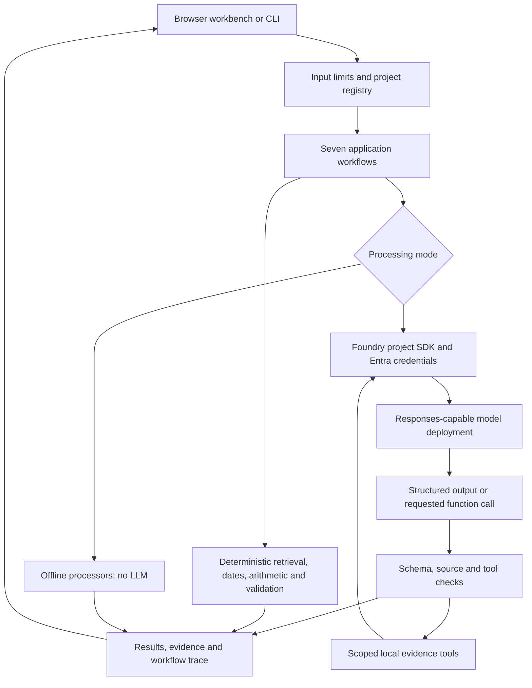

# Architecture

`portfolio/ai.py` owns the Foundry connection, schema checks, token/call budgets and
tool dispatch. `registry.py` restricts project selection and input size. Each app
implements its business rules and validates its own source references. The static
web client displays text using safe text nodes; it does not render model output as HTML.

## What is agentic here?

CaseFlow and Security Investigation Copilot let a model request tools, execute the
permitted function locally and feed a correlated result back to the model. The
application requires evidence reads before accepting a final handoff. Proposal
Studio uses three sequential model roles with explicit intermediate artifacts; it
is a staged workflow, not a deployed multi-agent service. The other applications
are retrieval or extraction workflows with deterministic checks.

## Trust boundaries

- All input, documents, tool results and generated text are untrusted. A prompt
  requests good behavior; application code enforces the controls it can actually check.
- Tool names, argument keys/types and selected record scope are checked in code.
  Tool handlers have no cloud-write, payment or messaging credentials.
- Invoice arithmetic and notice-date subtraction happen outside the model.
  Source ID membership and literal quotes are checked, but meaning and completeness
  still require a person to review them.
- Live mode is opt-in at server startup and per run. Cross-origin browser requests
  cannot invoke paid calls through the UI endpoint. The server is local-only, with
  no application login; it is not an internet-hosting configuration.
- Source data is synthetic. A real deployment requires client-approved data access,
  retention, authorization, audit, evaluation and support arrangements.

## Deliberate limits

No OCR, vector database, live Sentinel/Graph integration, external task tracker,
calendar writer, deployed hosting, persistent agent memory or production user
authentication is included. The documented live integration invokes project models;
it does not create a hosted Agent Service resource. Citation checks do not prove
factual entailment, nor do tests prove resistance to every prompt injection.

The custom JSON Schema validator supports only the subset in `portfolio/ai.py` and
fails on unsupported rules. Offline retrieval is lexical BM25, not semantic vector
search. Contracts use explicit ISO dates and calendar-day arithmetic. These choices
keep the demonstrations inspectable and inexpensive to reproduce.
