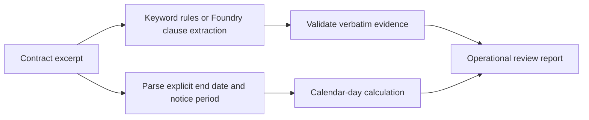

# Contract Radar

**Sayeem Chowdhury · original AI-assisted portfolio application**

Contract Radar helps an operations team find contract language to review and see
when an upcoming renewal may require attention. It links every extracted clause to
its source and calculates a notice date from explicit dates and calendar-day periods.
It makes no compliance, enforceability or legal judgment.

## Try the application

From the portfolio root:

```bash
python3 run.py contract-review
python3 server.py
```

Choose **Contract Radar** in the browser. Edit the contract, remove a clause or change
the end date and run again. `fixtures/contract.txt` contains the complete synthetic
example. The supported timeline input is deliberately explicit:

```text
Contract: DEMO-MSA-07
End date: 2027-02-28
Notice period: 60 days
Renewal: Automatically renews for one year unless written notice is received.
Security: Supplier maintains access controls and annual security testing.
```

For an as-of date of 22 November 2026, the supported calculation produces a notice
deadline of 30 December 2026, 38 days away. The application otherwise uses today's
date, or an explicit `as_of` value supplied in its payload.

## What it demonstrates

- Rule-based clause location offline; structured clause classification with Microsoft
  Foundry in live mode.
- Six review categories: renewal, security, breach notification, data processing,
  subprocessors and liability.
- Verbatim quotation checks and one-based source-line validation.
- Deterministic date calculations outside the model and explicit handling of missing
  or conflicting terms. Multiple end dates never silently choose one.
- Missing language creates review questions about the excerpt, not a legal finding.



## Microsoft Foundry path

The shared live adapter sends numbered source lines through the Foundry project's
Responses API and asks for permitted clause categories with verbatim quotes. The
application checks that the quotes exist before displaying them. Date extraction
and calculations stay in application code. See the root setup guide. Live Azure
execution remains unverified; local tests include rejection of a fabricated live quote.

## Verify it yourself

```bash
python3 -m unittest discover -s projects/contract-review/tests -v
```

Eight preparation tests passed. Manual checks: remove the notice period, add a second
end date, remove the security clause, and test an already-passed notice deadline.
Expect incomplete timelines for missing or conflicting terms and an explicit
`deadline_passed` state when appropriate.

## Scope and client adaptation

Clause presence does not establish adequacy, compliance or enforceability. Offline
matching can miss paraphrases or match negated language. The live model can also
misclassify a real quotation. The timeline assumes whole calendar days and does not
interpret business days, delivery methods, governing law, time zones or contract
hierarchy. No renewal notice is sent, and no contract system is connected.

A client version could ingest approved contract exports, add authenticated review
assignments, and connect a renewal calendar after human approval. The synthetic
fixture and this application's output are demonstrations, not legal advice.
