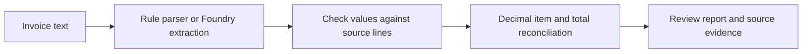

# Invoice Check

**Sayeem Chowdhury · original AI-assisted portfolio application**

Invoice Check helps a small business review a supplier invoice before authorizing
payment. It extracts the document's stated fields, computes item totals with decimal
arithmetic, and separates extraction from financial validation. It never pays an invoice.

## Try the application

From the portfolio root:

```bash
python3 run.py invoice-validator
python3 server.py
```

In the browser, select **Invoice Check**. Start with the example, then change an item
quantity or the stated total and run again. Use `fixtures/invoice.txt` as editable
plain-text input. Input fields use `Label: value`; items use
`Item: description | quantity | unit price`.

```text
Invoice: INV-104
Vendor: Northwind Demo Studio
Currency: EUR
Item: Security architecture workshop | 2 | 150.00
Item: Written handover | 1 | 80.00
Subtotal: 380.00
Tax: 87.40
Total: 467.40
Due: 2026-12-15
```

## What it demonstrates

- Editable plain-text extraction in offline mode; structured model extraction through
  the shared Microsoft Foundry client in live mode.
- Source-line checks reject extracted values that do not occur in the invoice.
- Application code reconciles line totals and subtotal plus tax using `Decimal` and
  round-half-up at the item level. The model cannot override the calculation.
- Duplicate totals, missing fields, invalid quantities, malformed dates and arithmetic
  differences trigger a human-review state.



## Microsoft Foundry path

The shared live adapter uses a Microsoft Foundry project endpoint, Entra authentication
and the Responses API. This app sends numbered invoice lines and requests a structured
extraction, then applies its local evidence and arithmetic checks. See the portfolio's
Foundry setup guide for configuration. Live cloud inference has not been executed or
verified during project preparation; offline behavior and a fake live extraction are tested.

## Verify it yourself

```bash
python3 -m unittest discover -s projects/invoice-validator/tests -v
```

Eight preparation tests passed. Manual checks: run the original fixture, change
`Total: 467.40` to `Total: 400.00`, duplicate the total line, and remove the currency.
The original should pass arithmetic checks; all three edits should require review.

## Scope and client adaptation

This is plain-text extraction, **not OCR**. It does not read scanned PDFs, establish
supplier authenticity, verify bank details, validate tax law, convert currencies or
process credit notes. Supported prices have at most two decimal places; supported
quantities have at most three. The three-letter currency format is checked without
claiming a complete currency registry. Human payment authorization is always separate.

A client extension could connect approved OCR and procurement records, add jurisdiction-
specific checks, and persist a reviewer audit trail. Those integrations are not present.
No client invoices or CV content are included in this project.
