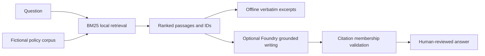

# Evidence Desk — Knowledge Assistant

**Portfolio owner: Sayeem Chowdhury · Original AI-assisted learning application**

Employees often spend time finding a policy before they can act on it. Evidence Desk
searches a small fictional company knowledge base, displays ranked source passages,
and can ask a Microsoft Foundry model to write a cited answer from those passages.

## Run

From the portfolio root:

```bash
python3 run.py knowledge-assistant
```

This prints the default scenario as JSON. Start the editable browser workbench with
`python3 server.py`, then open `http://127.0.0.1:8765` and select this project. Try:

- `How quickly must a departing employee's access be removed?`
- `What receipt is needed for travel reimbursement?`
- `What does the policy say about quantum computing?` — should abstain.

No LLM is called in offline mode. BM25 ranks the local passages and returns verbatim
evidence excerpts with IDs. This is useful working retrieval, rather than a canned
answer. It supports lexical matches and modest plural normalization; semantic
paraphrases without shared vocabulary may not retrieve the right passage.

## Microsoft Foundry path

With live mode enabled in the shared runtime, retrieved passages are supplied to the
Foundry Responses API through `AIProjectClient.get_openai_client()`. The model returns
an answer plus structured source IDs. The app rejects IDs outside the retrieved set
or an answer with no citations. It does not independently prove that every statement
is entailed by its cited passage. A reviewer still checks the answer.

See [shared setup](../../docs/SETUP.md). The live cloud path has not been verified
against an actual deployment. No Azure AI Search index or vector embedding is claimed.

## Architecture



## Validate and demonstrate

Run `python3 -m unittest discover -s projects/knowledge-assistant -p 'test_*.py' -v`.
Tests cover ranking, query variation, no-evidence abstention, blank input, and live
response citation checks with a fake model. For a manual demo, compare offboarding
and travel queries, inspect their different top-ranked evidence, then try an unknown
topic. Live quality, hallucination rate, latency and cost require a separate cloud run.

## Client value and extension

Useful as a starting point for an internal helpdesk or employee policy portal. A client
implementation would add document ingestion, permission-aware retrieval, versioning,
access logging and evaluation on their own questions. Sample policies here are made
up and are not compliance advice. No private CV or customer information is bundled.
