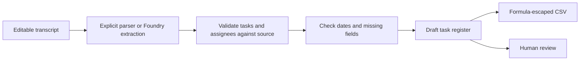

# Meeting to Momentum

**Sayeem Chowdhury · original AI-assisted portfolio application**

Meeting to Momentum turns a transcript into a draft action register with source
lines, named owners when explicit, dates when stated, decisions and blockers.
It helps a project team make a handover reviewable without silently inventing work.

## Try the application

From the portfolio root:

```bash
python3 run.py meeting-actions
python3 server.py
```

Choose **Meeting to Momentum** in the browser and edit the sample transcript.
The full synthetic input is in `fixtures/transcript.txt`. Offline mode supports
explicit `ACTION` rows and named speakers saying `I will`:

```text
Maya: Decision: Use synthetic data for the demonstration.
ACTION: Maya | Update the deployment runbook | 2026-12-02
Omar: I will review the access policy by 2026-12-03.
Priya: Blocker: We need the approved data retention period.
ACTION: Unassigned | Confirm the acceptance criteria | not set
```

## What it demonstrates

- Useful marker-based parsing offline and structured natural-language extraction
  through Microsoft Foundry in live mode.
- Verbatim task/source validation and explicit-source checks for owners and dates.
- Unassigned owners and missing dates stay unset and receive review flags.
- Duplicate task drafts are deduplicated; invalid dates remain visible for correction.
- A CSV draft is included in the result, with formula-like cells escaped before
  opening them in a spreadsheet. No task manager or calendar is mutated.



## Microsoft Foundry path

The shared live adapter sends numbered transcript lines to the Foundry project's
Responses API. It requests tasks, decisions and blockers in a schema and returns
the model output to local source/date checks. Missing owners and dates must be null.
See the root setup guide. Live cloud inference has not been run during preparation;
the tests use offline behavior and one fake live response to test evidence rejection.

## Verify it yourself

```bash
python3 -m unittest discover -s projects/meeting-actions/tests -v
```

Eight preparation tests passed. Manual checks: change the owner to `Unassigned`,
remove a date, duplicate an action, and add `Maya: We might build a dashboard.`
Missing fields should remain unset, the duplicate should collapse, and the discussion
should not become a task in offline mode. Inspect each source line before approving.

## Scope and client adaptation

This application accepts text, not audio. There is no speech recognition, speaker
diarization, email delivery or calendar integration. Offline rules intentionally
favor explicit commitments over implied actions. Relative dates are not resolved.
Grounding checks confirm literal support, not that a model interpreted a commitment
correctly. All outputs remain drafts requiring a meeting participant's review.

A client extension could add consented transcription, an approval queue, and an
authenticated task-system integration with idempotency keys. Those integrations
are not implemented. No real meeting or CV content is included in the fixtures.
