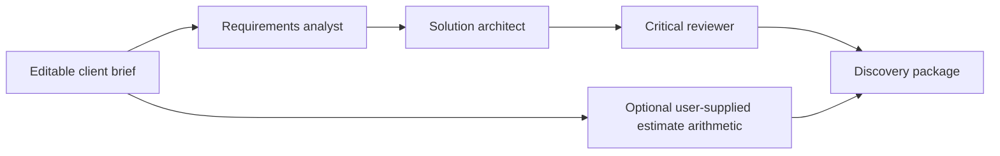

# Freelance AI Proposal Studio

**Sayeem Chowdhury | AI-assisted original portfolio application**

Turn an early client brief into a reviewable discovery package. The application
produces separate requirements, solution-design and reviewer artifacts, then computes
an illustrative subtotal only when the user supplies both hours and an hourly rate.
This demonstrates a useful freelance workflow without inventing a quote or promising delivery.

## Run it

From the portfolio root:

```bash
python3 run.py proposal-studio
python3 -m unittest discover -s projects/proposal-studio -p 'test_app.py' -v
```

Enter a freeform brief or use these optional labeled lines:

```text
Client: Fictional company
Problem: Our support team needs answers from internal policy documents.
Users: 12 analysts
Data: Internal Markdown documents
Integrations: Microsoft Teams
Requirements: Cite sources; abstain when evidence is missing.
Deadline: Pilot in six weeks
Estimate hours: 60
Hourly rate EUR: 70
```

Edit the problem to invoice extraction to see a different architecture in offline
mode. Remove the estimate assumptions to get a discovery-required result without
pricing. Supplied estimates use Decimal arithmetic; the example yields EUR 4,200.00
before tax or Azure usage. It remains illustrative and is not a binding quote.

## Foundry integration

Live mode makes three sequential structured-output requests to the shared Microsoft
Foundry backend: requirements analyst, solution architect, then critical reviewer.
Each stage receives the previous artifact. The first stage must reference real brief
line IDs. Pricing assumptions are kept out of the model-stage input; application code
alone performs estimate arithmetic. These are distinct roles in one controlled workflow,
not independently deployed autonomous agents.

See [setup](../../docs/SETUP.md). Live Foundry execution is unverified; offline mode
uses deterministic parsing and design heuristics, not a model.



## What a client can inspect

- Requirements and uncertainties traced to the supplied brief.
- A minimal solution pattern with phases, exclusions and acceptance checks.
- Separate critical review covering permissions, evaluation, cost and ownership.
- A nonbinding estimate derived from explicit assumptions or a request for discovery.
- No email, contract, calendar or CRM write is performed.

Manual QA: change the business problem, remove integrations, supply only one price
assumption, enter a negative/NaN number, and repeat a labeled field. The application
should adapt the scope or clearly reject the input rather than fabricate missing values.

This original portfolio code and fictional example were prepared with AI assistance.
It does not establish client engagements, commercial outcomes, cloud deployment or
independent authorship of AI-generated additions. Review live output for unsupported
claims before using it with a client. No proposal is sent automatically.
