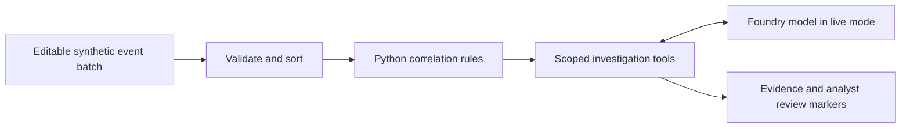

# Security Investigation Copilot

**Sayeem Chowdhury | AI-assisted original portfolio application**

Security teams need an explainable starting point for triage. This application takes
an editable batch of synthetic sign-in and storage events, sorts a timeline, correlates
failures followed by a successful sign-in, and identifies public-access setting changes.
Every finding carries source event IDs. It drafts review markers without executing containment.

## Run it

From the portfolio root:

```bash
python3 run.py security-investigator
python3 -m unittest discover -s projects/security-investigator -p 'test_app.py' -v
```

The browser hub lets you edit the JSON, remove events or change timestamps/IPs, then rerun.
The example produces two heuristic signals: three failures followed by success within
10 minutes from the same supplied IP, and an enabled storage public-access setting.
Neither proves an incident. Change the success timestamp beyond that window to see the
identity signal disappear. An IP address is required for that correlation.

## Foundry integration

In live mode the Microsoft Foundry model investigates through `list_entities`,
`inspect_user`, `get_findings` and `propose_review`. The application restricts tools to
the submitted batch and rejects a handoff if the model never reads computed findings.
The shared runtime validates function arguments and bounds tool calls.
See [setup](../../docs/SETUP.md) for the project endpoint, model and Entra sign-in.
This is a client-orchestrated tool loop using Foundry model inference, not a deployed
Sentinel connector or hosted Foundry Agent Service deployment.



## Design and limitations

- Offline mode executes Python correlation rules; no LLM is simulated or claimed.
- Input accepts 1–200 events with unique IDs, timezone-aware ISO timestamps and valid IPs.
- Tool calls cannot query arbitrary users outside the submitted batch.
- Outputs contain evidence IDs, the chronological input, uncertainty and zero executed actions.
- Public-access detection is a configuration review signal, not a data-leak finding.
- Live model wording can still be wrong; an analyst must review evidence and proposals.
- No Sentinel, Defender, Graph, actual account or incident-data connection is included.

Manual checks: reorder the batch, use a different successful-sign-in IP, delete one
failure, enter invalid JSON, and attempt an unknown entity through a tool test. All
results should remain local and no action should be marked executed.

The code, fictional records and documentation were prepared with AI assistance for
this portfolio. Local functional tests are provided. Live Foundry execution has not
been verified; do not present it as completed cloud deployment experience.
