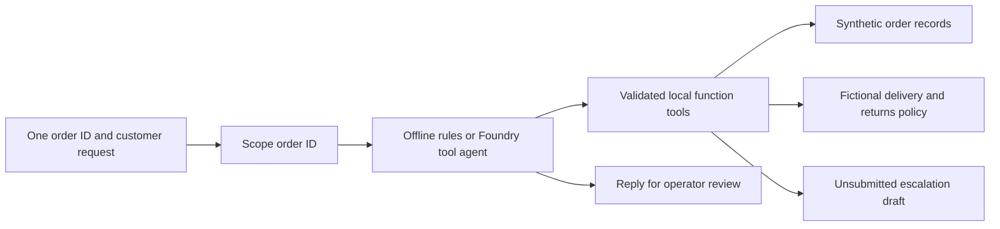

# CaseFlow — Customer Support Agent

**Portfolio owner: Sayeem Chowdhury · Original AI-assisted learning application**

CaseFlow demonstrates a common freelance automation request: turn an order inquiry
into a useful, evidence-based reply and an escalation draft while retaining an
operator's approval. It reads synthetic orders and fictional policies only.

## Run and try it

From the portfolio root:

```bash
python3 run.py support-agent
```

This prints the default scenario as JSON. For the browser editor, start
`python3 server.py`, open `http://127.0.0.1:8765` and select this project. Try:

- `My order ORD-1001 is delayed. Can you escalate it?`
- `I want to return ORD-1002.` — twelve days after delivery at the fixture date.
- `I want a refund for ORD-1003.` — outside the ordinary thirty-day review window.
- `Where is ORD-9999?` — should report that the order is unknown.

The reference date defaults to 22 November 2026 so the demo is reproducible.
The API accepts an optional ISO `as_of` field for another review date. Offline mode
uses real date arithmetic, order lookup and rules to prepare a draft. It is not an LLM.

## Microsoft Foundry integration

The optional live path uses the shared bounded Responses API tool loop. The model can
request `get_order`, `get_policy` and `draft_escalation`. An application-side check
restricts lookup and drafts to the one selected order, requires a lookup before a
draft, validates the reason length and deduplicates drafts. There are no send, refund,
payment or real ticketing tools. Generated text always requires review; a model's
claims cannot override the explicit `submitted: false` and `refund_issued: false` data.

See [Foundry setup](../../docs/SETUP.md). Live inference has not been run against a
real deployment. This is client-side tool orchestration, not a claim of hosted-agent
deployment, CRM integration or verified customer-support accuracy.

## Architecture



## Validation and client extension

Run `python3 -m unittest discover -s projects/support-agent -p 'test_*.py' -v`.
Tests cover date-window outcomes, changed dates, absent/multiple order IDs, unknown
orders, cross-order denial, lookup-before-draft, deduplication and a fake live-agent
tool contract. A manual reviewer should compare all three known orders and confirm
that no refund or submission is reported as executed.

For a real client, add customer authentication, a permitted-order mapping, an audited
ticketing connection and a separately authorized send step. An order ID by itself is
not sufficient authorization for a production system. No private CV or real customer
records are included here.
