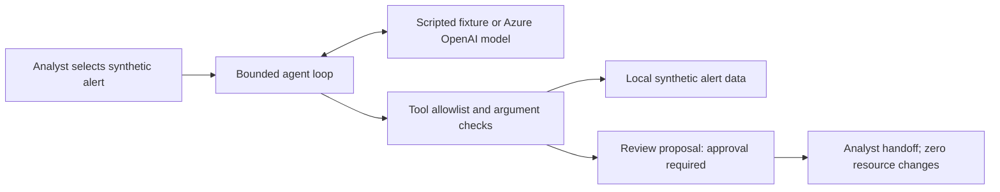

# Azure Agentic Security Triage

**Sayeem Chowdhury · AI-assisted portfolio project · synthetic data only**

A small security analyst assistant that demonstrates the agent loop: request a tool,
validate and execute it in application code, return the result, then produce an analyst
handoff. It can propose a review action, but cannot modify Azure resources.

This is an educational adaptation inspired by [Tim Warner's AI-103 Lesson 10](https://github.com/timothywarner-org/ai103/tree/55aca6dca5dde232e277d7076082ca59bd30963c/lessons/10-build-agents-foundry).
Tim Warner authored the upstream course and example. The unmodified reference and its
MIT notice are in `vendor/ai103/`. The application here is a new implementation with a
security-triage scenario, runtime validation, deterministic fixtures, tests and documentation.
See [PROVENANCE.md](PROVENANCE.md) for exact reuse boundaries and AI assistance disclosure.

## Try it without an Azure account

Requires Python 3.10 or newer. No packages to install.
From this project directory:

```bash
python3 agent.py --alert ALERT-001
python3 agent.py --alert ALERT-002
python3 -m unittest discover -s tests -v
```

Offline mode is a scripted simulation, not an LLM. It exercises the same orchestrator
and tool validation used by the optional live backend. The JSON output labels its mode,
lists tool decisions, shows `approval_required`, and reports `actions_executed: 0`.

## What was added for this portfolio

| Area | New implementation |
| --- | --- |
| Scenario | Two synthetic identity and storage alerts with evidence IDs and uncertainty |
| Agent loop | Tool-call/result correlation, response completion checks and bounded calls |
| Controls | Tool allowlist, exact argument checks, per-alert scope and evidence-before-proposal |
| Review gate | Proposal-only result; no approval bypass or remediation executor exists |
| Azure path | Entra-authenticated Azure OpenAI v1 Chat Completions using an existing deployment |
| Validation | Offline behavioral tests and a mocked Azure request contract test |
| Documentation | Architecture, setup, limitations, evidence checklist and upstream provenance |

## Architecture



See [architecture and trust boundaries](docs/ARCHITECTURE.md) and
[reproducible Azure setup](docs/SETUP.md). The live backend uses the resource root
endpoint, unlike the upstream example's Foundry project endpoint and Agent Framework.

## Verification and honest portfolio use

Offline validation is recorded in [VALIDATION.md](docs/VALIDATION.md).
Azure deployment and live model execution have **not** been verified. This repository
does not claim production deployment, completed coursework, certification or independent
authorship of the upstream material. AI assistance was used to prepare the new project.

Before describing it as hands-on Azure experience, run the live checklist, review every
tool decision, and add your own dated observations. [PORTFOLIO.md](docs/PORTFOLIO.md)
provides a demonstration script and evidence checklist.

## License

The upstream reference retains its original MIT license and Tim Warner copyright.
The new project files are offered under the MIT terms in [LICENSE](LICENSE).
No course branding, credentials or author identity has been transferred to this project.
